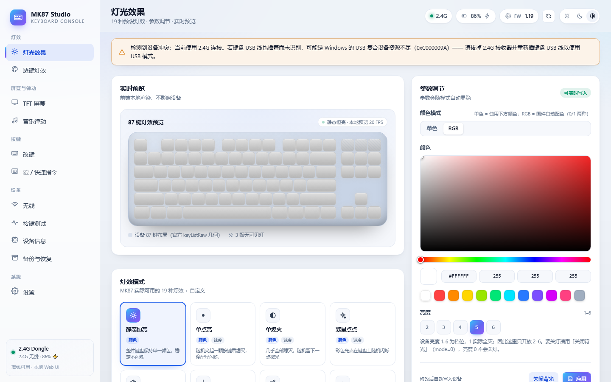
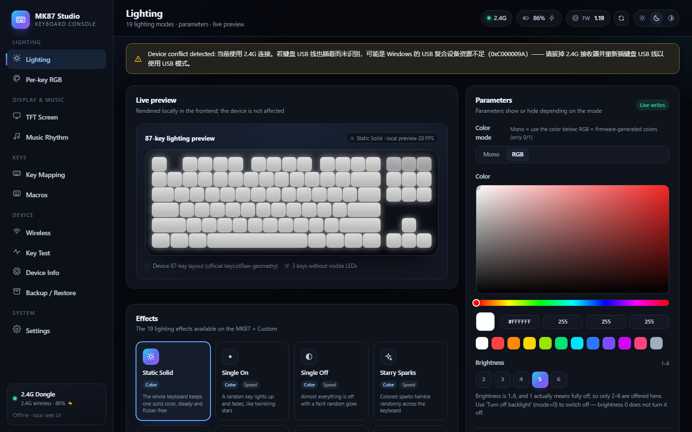
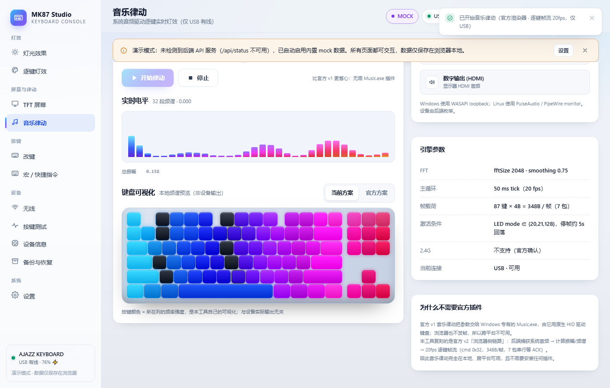
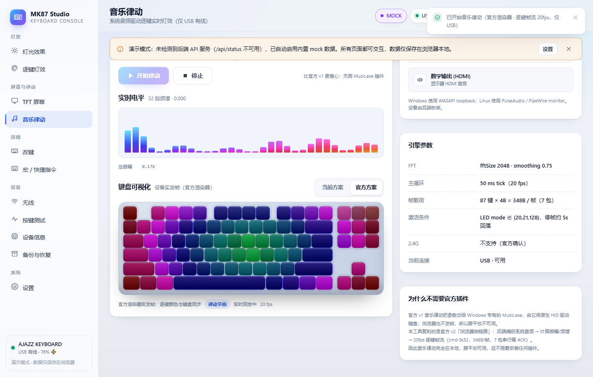
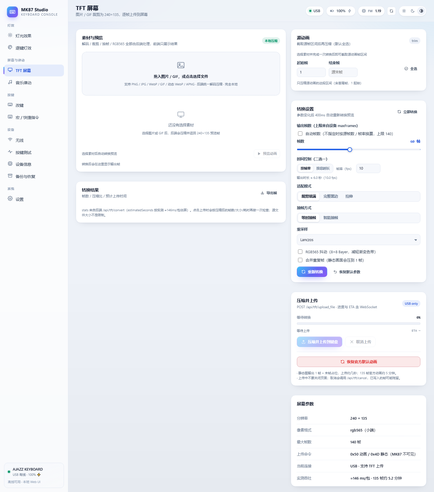
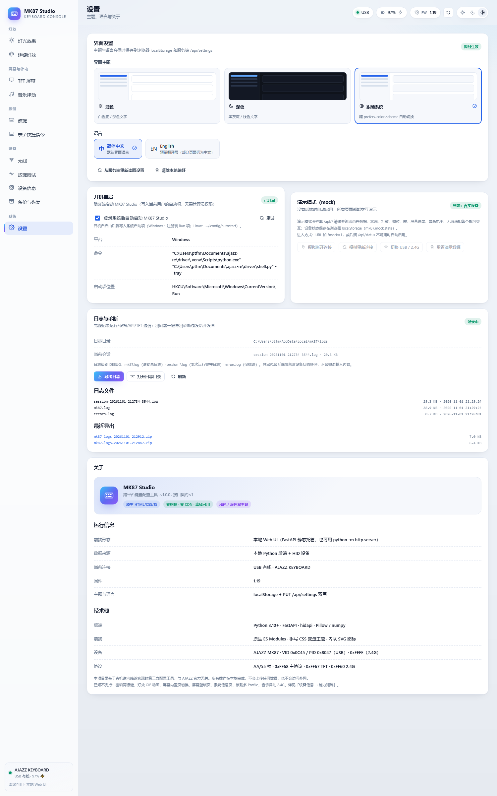

# MK87 Studio · AJAZZ MK87 跨平台配置工具

**MK87 Studio** 是 AJAZZ MK87 机械键盘（USB `0C45:8047` / 2.4G `0C45:FEFE`）的非官方跨平台配置工具，基于真机协议逆向实现。全部功能离线本地运行：不访问外网、不上传数据、不依赖官方驱动。

**MK87 Studio** is an unofficial cross-platform configuration tool for the AJAZZ MK87 mechanical keyboard, built from hardware reverse engineering. Everything runs fully offline and locally — no telemetry, no network access, no vendor driver required.

| | |
|---|---|
| **平台 / Platform** | Windows 10/11 · Linux |
| **界面 / UI** | 本地 Web UI（原生窗口或浏览器）/ Local web UI (native window or browser) |
| **主题 / Theme** | 浅色 · 深色 · 跟随系统 / Light · Dark · System |
| **语言 / Language** | 简体中文 · English（即时切换 / live switch） |
| **许可 / License** | MIT |

---

## 界面 / Screenshots

| 灯光效果（浅色 · 中文）<br>Lighting (light · zh) | 键盘预览（深色 · English）<br>Visualizer (dark · en) |
|---|---|
|  |  |

| 音乐律动 · 当前方案<br>Music rhythm · Current | 音乐律动 · 官方方案<br>Music rhythm · Official |
|---|---|
|  |  |

| TFT 屏幕 / TFT screen | 日志与诊断 / Logs & diagnostics |
|---|---|
|  |  |

> 音乐律动两张为无硬件演示模式截图；其余为真机界面截图。
> The two music screenshots are demo-mode captures without hardware; the rest are real-device UI.

## v0.1.1 更新 / What's new in v0.1.1

**中文**

- **音乐律动**页键盘预览新增「当前方案 / 官方方案」双标签：官方方案实时回放后端发给键盘的逐键帧（与键盘逐键同步），当前方案保留原频谱动画，可随时对比。
- 修复英文界面首屏 `<html lang>` 未同步、动态模式名（律动节拍等）不翻译的问题。
- 新增音乐预览离线回归测试与 headless Chrome UI 自检脚本。
- 文档：WebSocket `music_frame` 契约、音乐页说明更新。

**English**

- The music page keyboard preview now has two tabs — **Current** (the local spectrum animation) and **Official** (replays the exact per-key frames the backend sends to the keyboard, frame-accurate).
- Fixed the English UI: `<html lang>` was not set on first paint, so dynamic mode names stayed in Chinese.
- Added offline regression tests for the music preview and a headless-Chrome UI self-check script.
- Docs: WebSocket `music_frame` contract and music page notes updated.

## 下载 / Downloads

| 平台 / Platform | 文件 / File | 安装 / Install |
|---|---|---|
| Windows | `MK87Studio-*-win64-portable.zip` | 免安装：解压后双击 `MK87Config.exe`<br>Portable: unzip and run `MK87Config.exe` |
| Windows | `MK87Studio-*-win64-setup.exe` | 安装版：开始菜单/桌面快捷方式，可选开机自启<br>Installer: shortcuts, optional autostart |
| Linux · Debian/Ubuntu | `mk87_*_amd64.deb` | `sudo apt install ./mk87_*.deb` |
| Linux · Fedora/openSUSE | `mk87-*.x86_64.rpm` | `sudo dnf install ./mk87-*.rpm` |

Linux 包内已包含 udev 规则（免 root 访问 HID），安装后请重新插拔键盘。
Linux packages ship with the udev rules (root-free HID access); replug the keyboard after install.

附件含 `SHA256SUMS.txt` 校验值。 / Checksums are attached as `SHA256SUMS.txt`.

## 功能 / Features

- **改键 / Key mapping** — 87 键主层 + FN 层；HID 键码、组合键、宏、媒体键、禁用、恢复默认；实时预览 4B 编码。
  87-key normal + FN layers; HID keys, combos, macros, media keys, disabled, restore-defaults; live 4-byte encoding preview.
- **宏 / Macros** — 100 槽 / 3072B：录键、延迟、按下/抬起、重复 N 次、再按结束。
  100 slots / 3072 B: record keys, delays, press/release, repeat N times, press-to-stop.
- **灯效 / Lighting** — 19 种预设 + 颜色/亮度/速度/方向；RGB/单色；逐键自定义灯。
  19 presets with color / brightness / speed / direction; RGB or single color; per-key custom lighting.
- **音乐律动 / Music rhythm（仅 USB / USB only）** — 系统音频回环 → 官方渲染器（律动节拍 / 光尘螺旋 / 萤火轨迹 / 曲率频谱）→ 20fps 逐键帧流；页面预览可切换「当前方案 / 官方方案」。
  System audio loopback → official renderers → 20 fps per-key frame stream; preview switchable between Current and Official.
- **TFT 屏幕 / TFT screen（240×135）** — 图片 / GIF / 动态 WebP / APNG 压缩上传（≤140 帧、RGB565、逐包 ACK）、时间同步、一键恢复官方默认动画。
  Image / GIF / animated WebP / APNG compression & upload (≤140 frames, RGB565, per-packet ACK), time sync, restore-default animation.
- **设备 / Device** — 固件 / 电量 / 能力矩阵、游戏模式字段、原始命令控制台（hex 收发）。
  Firmware / battery / capability matrix, game-mode fields, raw command console (hex).
- **无线 / Wireless** — 2.4G 连接状态、电量、休眠时间、断连 / 唤醒通知日志。
  2.4G status, battery, sleep timer, disconnect / wake notification log.
- **按键测试 / Key test** — Windows RawInput / Linux evdev 捕获，87 键三态高亮 + 事件日志 + 统计。
  Windows RawInput / Linux evdev capture, 87-key tri-state highlight, event log and stats.
- **备份恢复 / Backup & restore** — 全量 JSON 导出 / 导入，恢复前二次确认。
  Full JSON export / import with confirmation before restore.
- **主题与语言 / Theme & i18n** — 浅色 / 深色 / 跟随系统；简体中文 / English 即时切换。
  Light / dark / system; Simplified Chinese / English live switch.
- **其它 / Misc** — 系统托盘 + 开机自启、完整日志 + 一键导出诊断包、单实例。
  System tray + autostart, full logging with one-click diagnostic export, single instance.

## 已知限制 / Known limitations

- **音乐律动仅支持 USB 有线**（官方确认 2.4G 不支持帧流）。
  Music rhythm is USB-only (officially unsupported over 2.4G).
- **TFT 上传是独占总线操作**：上传期间请勿操作其它功能。
  TFT upload takes exclusive bus access; don't use other features while uploading.
- 屏幕内容**只能写不能读回**，换内容 / 恢复默认只能重传。
  Screen content is write-only — it cannot be read back.
- 2.4G 接收器与键盘 USB 同时插在同一 USB 2.0 Hub 时，Windows 可能因资源不足（`0xC000009A`）导致后枚举设备启动失败（详见 `docs/TEST-REPORT.md` §8.7）。
  When the 2.4G receiver and the keyboard USB share one USB 2.0 hub, Windows may fail to start the later-enumerated composite device (`0xC000009A`); see `docs/TEST-REPORT.md` §8.7.
- 磁轴高级键、灯效 GIF、屏幕内置页 / 壁纸页 / 系统信息页、板载多 Profile：固件 / 硬件不支持。
  Magnetic-switch advanced keys, GIF lighting effects, built-in screen pages (wallpaper / system info) and on-board profiles are not supported by the firmware / hardware.

## 从源码运行 / Run from source

```bash
git clone https://github.com/w32394045-dotcom/ajazz-mk87.git
cd ajazz-mk87/driver
python -m venv .venv

# Windows
.venv\Scripts\pip install -r packaging\requirements.txt
.venv\Scripts\python shell.py      # 原生窗口 / native window
# .venv\Scripts\python run.py      # 浏览器模式 / browser mode

# Linux
.venv/bin/pip install -r packaging/requirements.txt
.venv/bin/python shell.py           # 原生窗口（需 Qt WebEngine）/ native window
# .venv/bin/python run.py           # 浏览器模式 / browser mode
```

## 文档 / Documentation

- [`docs/FEATURES.md`](https://github.com/w32394045-dotcom/ajazz-mk87/blob/main/docs/FEATURES.md) — 功能总表与能力边界 / capability matrix
- [`docs/TEST-REPORT.md`](https://github.com/w32394045-dotcom/ajazz-mk87/blob/main/docs/TEST-REPORT.md) — 真机测试报告 / on-device test report
- [`docs/protocol.md`](https://github.com/w32394045-dotcom/ajazz-mk87/blob/main/docs/protocol.md) — 帧格式与命令表 / frame format & command table
- [`docs/music-rhythm.md`](https://github.com/w32394045-dotcom/ajazz-mk87/blob/main/docs/music-rhythm.md) — 音乐律动与逐键帧流 / music rhythm & frame stream
- [`docs/tft-page.md`](https://github.com/w32394045-dotcom/ajazz-mk87/blob/main/docs/tft-page.md) — TFT 屏幕协议 / TFT screen protocol
- [`docs/keymap.md`](https://github.com/w32394045-dotcom/ajazz-mk87/blob/main/docs/keymap.md) — 改键与宏格式 / keymap & macro format
- [`docs/lighting.md`](https://github.com/w32394045-dotcom/ajazz-mk87/blob/main/docs/lighting.md) — 灯效协议 / lighting protocol
- [`driver/README.md`](https://github.com/w32394045-dotcom/ajazz-mk87/blob/main/driver/README.md) — 工具本身的说明 / tool documentation

## 许可 / License

本项目代码采用 **MIT License**，见 [LICENSE](https://github.com/w32394045-dotcom/ajazz-mk87/blob/main/LICENSE)。

This project is released under the **MIT License** — see [LICENSE](https://github.com/w32394045-dotcom/ajazz-mk87/blob/main/LICENSE).

> 注意：`assets/`、`tools/Music.exe` 等原厂网页驱动 / 工具提取物版权归原厂所有，仅作研究留存，**不在 MIT 授权范围内**。
> Note: extracted vendor assets (`assets/`, `tools/Music.exe`, official bundle snippets under `docs/`) remain copyright of their respective owners and are **not covered** by the MIT license.

## 免责声明 / Disclaimer

本项目为非官方逆向工程，仅用于研究与个人使用，与 AJAZZ 官方无关。设备固件 / 协议可能随版本变化；写操作（改键、宏、灯效、屏幕内容）前请自行备份。

This is an unofficial reverse-engineering project for research and personal use only, not affiliated with AJAZZ. Device firmware / protocol may change; back up your settings before any write operation.

---

*本页由 GitHub Actions 自动构建发布 / Built and published automatically by GitHub Actions.*
