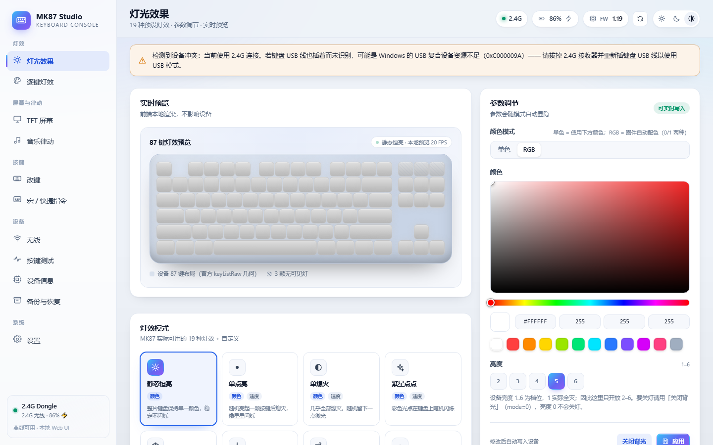
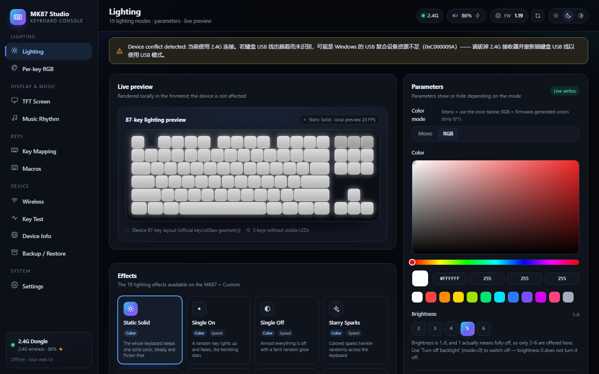
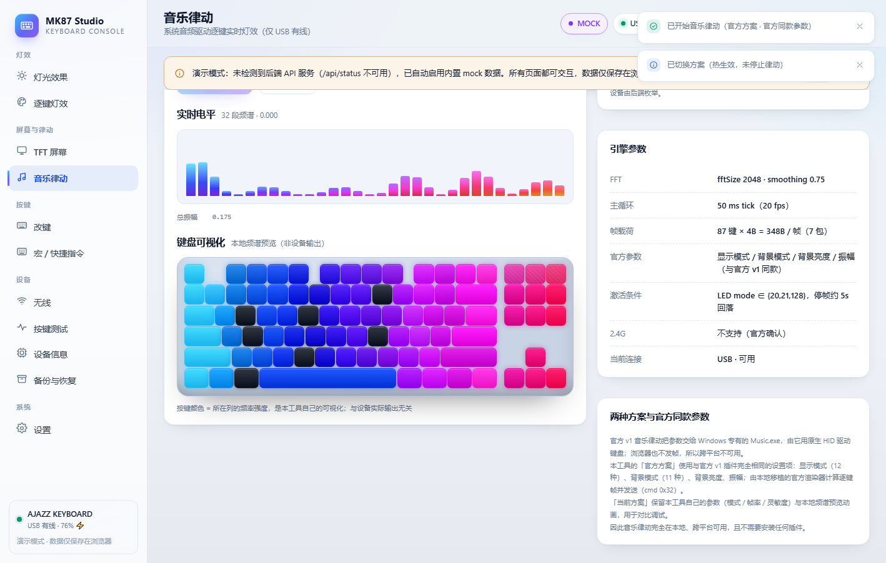
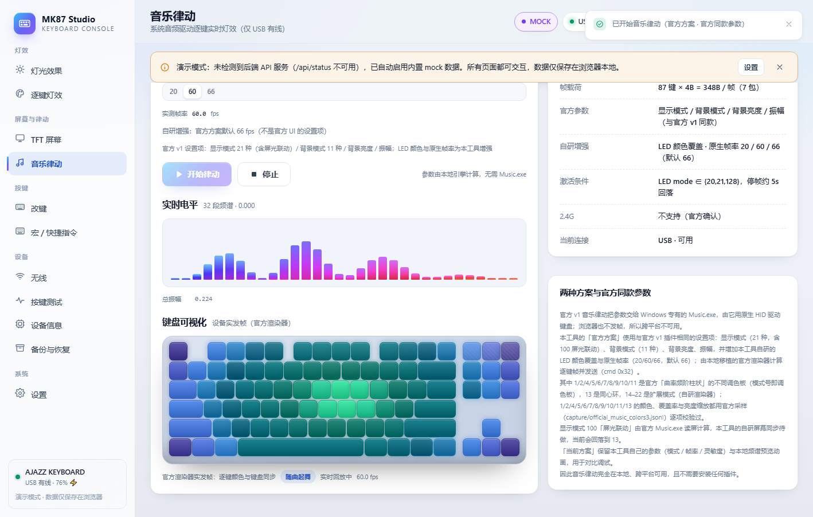
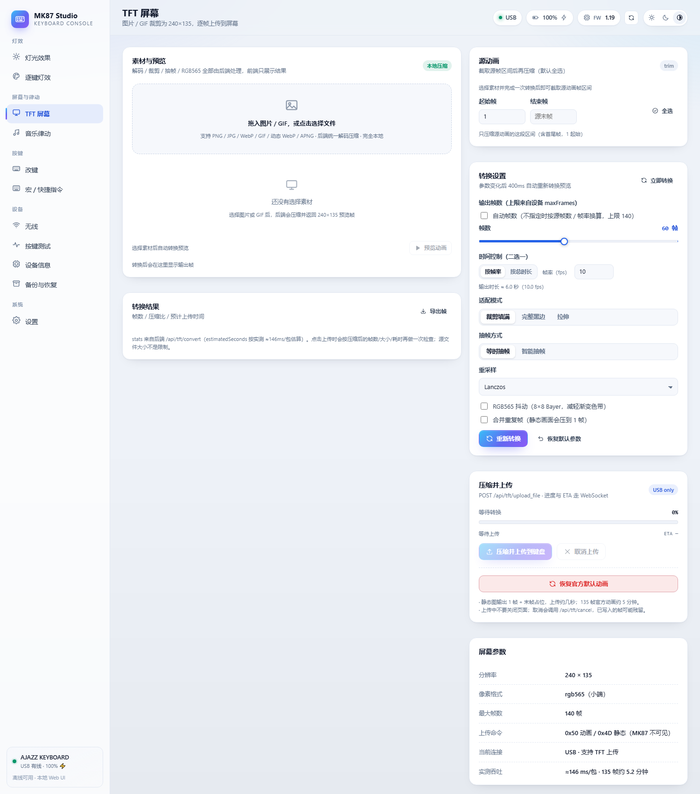
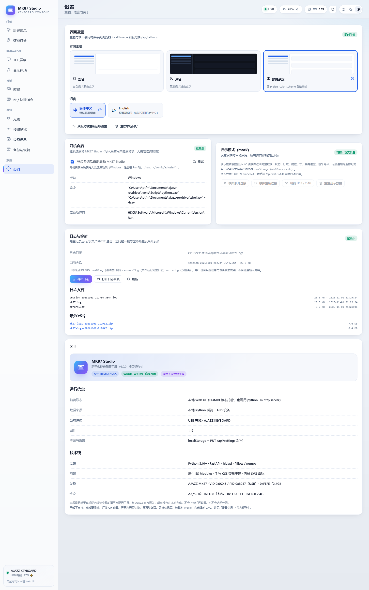

# AJAZZ MK87 · Reverse Engineering + Cross-platform Config Tool

**English** · [简体中文](README.zh-CN.md)

**MK87 Studio** is an unofficial, fully offline **cross-platform configuration tool** (Windows + Linux) for the
**AJAZZ MK87** mechanical keyboard, built from a complete reverse engineering of its USB / 2.4G protocol.

- **Device**: USB `VID 0x0C45 / PID 0x8047`; 2.4G receiver `VID 0x0C45 / PID 0xFEFE`
- **Official web driver** (reverse-engineered): `https://ajazz.driveall.cn`
- **Everything local**: no network access, no telemetry, no vendor driver required
- **Latest release**: [v0.1.6](https://github.com/w32394045-dotcom/ajazz-mk87/releases/latest)

## Screenshots

| Lighting (light · Chinese) | Dark UI (English) |
|---|---|
|  |  |

| Music rhythm · Current | Music rhythm · Official |
|---|---|
|  |  |

| TFT screen (240×135) | Logs & diagnostics |
|---|---|
|  |  |

> The two music screenshots are from demo mode (no keyboard attached); the others are real-device UI.

## Download

👉 **https://github.com/w32394045-dotcom/ajazz-mk87/releases/latest**

| Platform | File | Notes |
|---|---|---|
| Windows | `MK87Studio-*-win64-portable.zip` | Portable: unzip and run `MK87Config.exe` |
| Windows | `MK87Studio-*-win64-setup.exe` | Installer: shortcuts, optional autostart |
| Linux · Debian/Ubuntu | `mk87_*_amd64.deb` | `sudo apt install ./mk87_*.deb` |
| Linux · Fedora/openSUSE | `mk87-*.x86_64.rpm` | `sudo dnf install ./mk87-*.rpm` |

Linux packages ship the udev rules (root-free HID access); replug the keyboard after install.
Releases are built by GitHub Actions and come with a `SHA256SUMS.txt`.

If the app does not detect the keyboard on Linux, run the built-in self check first:

```bash
mk87 --diagnose     # prints hidapi backend, hidraw nodes, usage pages, permissions
```

It writes the same report to `~/.local/state/mk87/logs/diagnose.txt`. The app must use hidapi's **hidraw**
backend on Linux (module `hidraw`, paths `/dev/hidrawN`); the `hid` module bundled in the PyPI wheel is the
**libusb** backend and cannot be used for this keyboard (wrong device paths, no usage pages, USB-device
permissions and kernel-driver conflicts). See "What's new in v0.1.6".

## What's new in v0.1.6

- **Fixed: Linux still could not detect the keyboard (root cause of the v0.1.5 report)** — the PyPI `hidapi`
  wheel ships **two** extension modules on Linux: `hid` (built against **libusb**) and `hidraw` (built
  against **hidraw**). cython-hidapi's build defaults to libusb, so `import hid` on Linux returned the libusb
  backend: `enumerate()` paths look like `1-1.1:1.0` instead of `/dev/hidrawN`, `usage_page` is always 0
  (libusb cannot read the descriptor during enumeration), opening needs `/dev/bus/usb` permissions and fights
  the kernel HID driver. The tool now selects `hidraw` on Linux, which reports `/dev/hidrawN` paths and fills
  usage pages straight from sysfs — the v0.1.5 report-descriptor parsing stays as a fallback. Windows keeps
  using the native `hid` module; behaviour there is unchanged.
- **New: `--diagnose` self check** — `mk87 --diagnose` (or `python3 probe/linux_hid_check.py`
  from a source checkout) prints the hidapi backend, raw enumeration, parsed interfaces, every
  `/sys/class/hidraw/hidraw*` node with vid/pid/interface/usage page/permissions, the udev rule state and a
  verdict, and saves it to `~/.local/state/mk87/logs/diagnose.txt`.
- **Linux: clearer failures** — if only the libusb backend is present the tool now refuses to "connect" and
  tells you to install the official wheel / upgrade the package; the "not found" message points at
  `--diagnose`.
- **Linux: quieter startup** — pywebview is told to use its Qt backend directly, so the packaged app no
  longer logs a misleading `GTK cannot be loaded` traceback before falling back to Qt.
- Tests: **226 unit tests green** (11 new: backend selection/preference, interface-number 0 handling,
  sysfs HID_ID/interface parsing, libusb-style path fallback, libusb-backend guard). Windows regression
  re-checked on a real MK87: `connected=True fw=1.19 battery=100 tftMax=140`.

### v0.1.5

- **Attempted Linux fix (report-descriptor parsing)** — v0.1.5 assumed hidapi's hidraw backend leaves
  `usage_page = 0` on Linux and rebuilt interface identity by parsing each interface's HID report descriptor
  (hidapi `get_report_descriptor()`, falling back to
  `/sys/class/hidraw/hidrawN/device/report_descriptor`). The parsing is still used as a fallback, but the
  real problem was the **libusb** backend being imported — see v0.1.6.
- Diagnostics: the device log lists every enumerated interface (`product / pid / usagePage / usage /
  interface / payload / path`), and `probe/linux_hid_check.py` printed the same information.
- Tests: 215 unit tests green (9 Linux transport tests).

### v0.1.4

- **Fixed: key remapping / macro bindings could not be saved** — the keymap page sent `key` / `fn` / `combo`
  wire types while the backend encoder only accepted `keyboard` / `func` / `combo (mods + key)`, so every
  "Apply changes" returned HTTP 400. Backend now accepts both forms and the frontend emits the canonical
  schema; combo keys also round-trip correctly after a page reload. Verified on a real MK87 (canonical,
  alias-key, combo write + restore and FN-layer no-op saves all returned 200 with byte-identical readback).
- **Fixed: UI hiccups while music is playing** — the protocol layer logged every HID notification frame at
  DEBUG level (1,169,834 lines / 207 MB in one 47-minute 66 fps session). Notifications are now aggregated
  and rate-limited (≈33 KB/min, −99.9 %), session logs are capped at 32 MB and old sessions are pruned, and
  the macro table is read in bulk (`GET /api/macros` 48 s → 0.37 s; 201 → 7 requests).
- **Fixed: LED color overlay now covers every dynamic mode** — previously only 1/2/4/5/13; the restored
  modes 14–22 are now recolored too. Solid modes 6–11 keep their official sampled colors and `default`
  remains byte-for-byte identical (220-combination snapshot regression).
- **Fixed: mode 4 could flash the old synthetic contour** — a single frame with an all-zero spectrum (quiet
  passage / loopback dropout) used to switch Curvature Frequency Steps back to the legacy curvature outline.
  Once real spectrum has been received the renderer never falls back; silence means empty bars.
- **Fixed: Amplitude / Background-brightness sliders did not send their values** — their `onInput` handler
  never wrote the new value back, so hot-update always sent the previous 50/100. Dragging now applies live.
- **Fixed: browser-mode (`run.py`) logging** — uvicorn's default log config closed the tool's log handlers
  (empty session log + thousands of "Logging error" tracebacks on stderr). uvicorn now starts with
  `log_config=None`, same as the native shell.

### v0.1.3

- **Music rhythm · Official scheme aligned with the official v1 truth** — the display-mode dropdown is now
  **21 modes**: the 12 exposed by the official v1 UI plus the 9 modes (14–22) that had already been
  reverse-engineered but were not surfaced by the official UI. Mode 4 **Curvature Frequency Steps** was
  rewritten from fresh sampling of the official MusicPlug.exe: 17 frequency columns, bottom-aligned
  (1200/1200 frames), left-low → right-high on a log scale (~110 Hz–12 kHz), with a radial hue palette
  (origin `(2,8)`) rotating ~275°/s. Mode 100 (screen-light linkage) still falls back to Dance to the Beat.
- **LED color overlay (this tool's own enhancement)** — a third dropdown offers **default (official palette)
  + 9 presets**: ice blue `#00E5FF`, violet `#B36CFF`, hot pink `#FF2E88`, lime `#A8FF3E`, warm amber
  `#FF6A00`, sakura `#FF7AB6→#B36CFF`, aurora `#3EFF9A→#00E5FF→#7A5CFF`, sunset
  `#FFC400→#FF6A00→#FF2E88`, ice-fire `#00E5FF→#FEFEFE→#FF6A00`. It recolors all dynamic multicolor
  modes **1/2/4/5/13 and the restored 14–22**, keeping their original animation; solid modes 6–11 and the
  background are untouched, and `default` is byte-for-byte identical to v0.1.2 (220-combination snapshot
  regression).
- **Native 20 / 60 / 66 fps, default 66** — the official v1 plugin sends 530.5 packets/s ÷ 8 packets/frame
  ≈ **66.3 fps**, so the official scheme now defaults to 66 fps (Current keeps 15/20/30). ≤30 fps keeps
  per-packet ACK; ≥60 fps writes 7 packets back-to-back and drains ACKs asynchronously (synchronous
  frame-end drain measured 19.8 ms/frame → 45.96 fps; async 8.85 ms/frame → 66 fps). Animation is
  `dt`-normalized, so motion speed does not change with fps. The page shows measured fps; the status
  contract is `fps` (float|null, measured) / `targetFps` (int, configured), and WS preview is capped at 30 Hz.
  On a real MK87 (USB, fw 1.19) 66 fps held
  **65.78–65.89 fps for 100 s** (0 errors); 60 fps = 60.06, 20 fps = 19.97. 21 modes × 10 colors switched
  with 0 errors; stopping restored mode 11 / brightness 6 / speed 3.
- **Battery / lighting robustness** — battery, charging and work mode are re-read and logged on every poll
  (the connection log now carries battery/charging/workMode/transport, plus a delayed 2 s re-read after
  connect). 2.4G battery uses cmd `0x37` (first packet + `GET_ALL_LIGHTS_RGB_24G` response), with a
  3-failure / 5-minute circuit breaker that falls back to the USB path. The stuck-custom-lighting bug is
  fixed at the root: v0.1.2's music start wrote LED mode **128**, and if the process was killed during
  shutdown the restore never ran, so fw 1.19 turned 128 into a per-key custom table. The music path now
  **never writes 128**, enters frame mode with 20/21 and verifies by readback, refuses to restore
  snapshots whose mode is 0/invalid, restores lighting before closing the device manager, and marks `isCustom` via
  `GET_ALL_LIGHTS_RGB` when the mode reads back 0. (The "looks like game mode after reboot" report had the
  same cause; full logs show the tool never sent a game-mode `0x21` command — 0 entries.)
- **Quality** — 152 unit tests green; 17 headless-Chrome UI checks PASS (21 modes / 3 dropdowns / 10 colors /
  3 frame-rate tiers, live switching, no Chinese leakage in the English UI).

## Features

- **Lighting** — 19 presets with color / brightness (1–6) / speed (1–6) / direction; RGB or single color.
- **Per-key RGB** — 87-key canvas: paint, erase, fill, eyedropper, drag-paint, presets; writes the custom LED
  table shared by firmware modes 20 / 21 / 128.
- **TFT screen (240×135)** — image / GIF / animated WebP / APNG → compression pipeline (downscale, frame
  extraction, dedupe, RGB565 dithering) → animation upload (≤140 frames), time sync, restore official animation.
- **Macros** — 100 slots / 3072 B editor: record keys, delays, press/release, repeat N times, press-to-stop.
- **Key mapping / FN** — 87-key normal + FN layers: HID keys, combos, macros, firmware FUNC actions, disabled,
  restore-defaults, live 4-byte encoding preview. FN layer is read-only over 2.4G.
- **Music rhythm (USB only)** — two schemes: **Official** (21 display modes — the 12 official v1 modes plus
  the 9 restored modes 14–22 — 11 background modes, background brightness, amplitude and LED color overlay;
  hot-switchable while playing) and **Current** (this tool's own mode / frame rate / sensitivity) → native
  **20/60/66 fps** per-key frame stream (official scheme defaults to 66; official v1 measured ≈66.3 fps).
  Mode 4 is a 17-column bottom-aligned spectrum matching the official sampler, and the LED color overlay
  (default + 9 presets) recolors every dynamic mode (1/2/4/5/13 + the restored 14–22). Mode 100 (screen
  linkage) is computed by Music.exe, so it falls back to Dance to the Beat.
- **Wireless** — 2.4G status, battery, sleep timer (0/1/10/20/30 min), disconnect / wake notification log.
- **Key test** — OS-level capture (Windows RawInput / Linux evdev), 87-key tri-state highlight, event log, stats.
- **Device info** — firmware / battery / capability matrix, game-mode fields, time sync, raw command console.
- **Backup & restore** — full JSON export / import with confirmation before restore.
- **Settings** — light / dark / system theme, Chinese / English live switch, autostart, clean quit.
- **Misc** — system tray, single instance, full logging with one-click diagnostic export.

## Device capabilities (verified on hardware)

| Capability | Status |
|---|---|
| 87-key remapping (HID / combos / macros / FN / media keys) | ✅ read & write |
| FN layer remapping (26 default actions) | ✅ read & write |
| 19 lighting effects + brightness / speed + per-key custom LEDs | ✅ |
| Per-key live frame stream (native 20/60/66 fps, default 66; official v1 ≈66.3 fps; music / AI effects) | ✅ USB only (2.4G not supported by firmware) |
| Macros: 100 slots / 3072 B, format fully decoded | ✅ read & write |
| TFT 240×135 custom animation (≤140 frames, ~63 KB/s) | ✅ upload & play |
| Screen time sync | ✅ |
| Game mode / sleep settings, battery / firmware info | ✅ partial fields |
| 2.4G wireless (shares config with USB, same matrix) + disconnect / wake notifications | ✅ |
| Magnetic switches, GIF lighting, on-board profiles, built-in screen pages, 12/24h display | ⛔ not supported by firmware / hardware |

## Repository contents

1. **Reverse-engineering docs (`docs/`)** — protocol frame format, 66 command table, key/macro binary formats,
   19 lighting effect parameters, per-key LED frame stream, TFT screen (240×135 animation / time sync),
   music rhythm, 2.4G wireless (sleep/wake notifications), official i18n strings and an unknown-items list.
2. **Reference implementations & probes (`scripts/`, `probe/`, `capture/`)** — codec reference implementations
   with self-check assertions, Python HID clients that drive the device directly, and Chrome CDP WebHID capture tools.
3. **Cross-platform tool (`driver/`)** — the released Windows + Linux app covering all verified capabilities.

```
docs/       reverse-engineering docs and measured data (JSON evidence)
scripts/    reference implementations and extraction scripts (Node/Python)
probe/      on-device test scripts (Python + hidapi)
capture/    Chrome CDP WebHID captures and recorded evidence
assets/     official web-driver bundle extracts (analysis input)
driver/     cross-platform configuration tool (released)
```

## Reverse-engineering docs

- [docs/FEATURES.md](docs/FEATURES.md) — capability matrix and corrections (start here)
- [docs/TEST-REPORT.md](docs/TEST-REPORT.md) — on-device test report (Phase 0–7 with evidence)
- [docs/protocol.md](docs/protocol.md) — frame format and command table
- [docs/deepdive-mk87.md](docs/deepdive-mk87.md) — device info / game mode / screen time
- [docs/keymap.md](docs/keymap.md) — key mapping and macro binary format (§16)
- [docs/lighting.md](docs/lighting.md) — lighting protocol
- [docs/tft-page.md](docs/tft-page.md) — TFT screen protocol
- [docs/music-rhythm.md](docs/music-rhythm.md) — music rhythm and per-key frame stream
- [docs/wireless-profiles-led-animation.md](docs/wireless-profiles-led-animation.md) — 2.4G wireless
- [docs/key-events.md](docs/key-events.md) — key event capture (no vendor event frames; RawInput/evdev required)
- [docs/i18n-and-unknowns.md](docs/i18n-and-unknowns.md) — official strings and open questions
- [driver/README.md](driver/README.md) — the tool itself (Chinese)

## Build & run from source

```bash
git clone https://github.com/w32394045-dotcom/ajazz-mk87.git
cd ajazz-mk87/driver
python -m venv .venv

# Windows
.venv\Scripts\pip install -r packaging\requirements.txt
.venv\Scripts\python shell.py      # native window (recommended)
# .venv\Scripts\python run.py      # browser mode

# Linux
.venv/bin/pip install -r packaging/requirements.txt
.venv/bin/python shell.py           # native window (needs Qt WebEngine)
# .venv/bin/python run.py           # browser mode
```

## License

MIT — see [LICENSE](LICENSE).

> Extracted vendor assets (`assets/`, `tools/Music.exe`, official bundle snippets under `docs/`) remain
> copyright of their respective owners and are **not covered** by the MIT license.

## Disclaimer

This is an unofficial reverse-engineering project for research and personal use only, not affiliated with
AJAZZ. Device firmware / protocol may change; back up your settings before any write operation.
