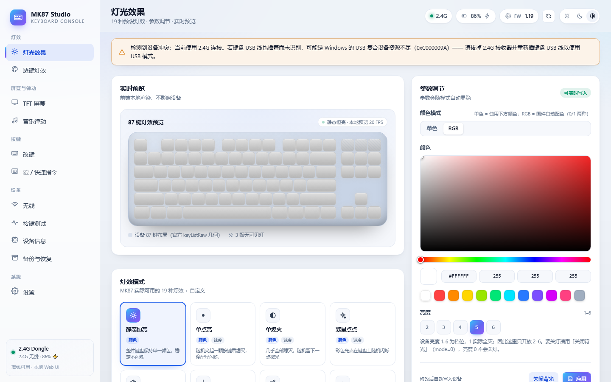
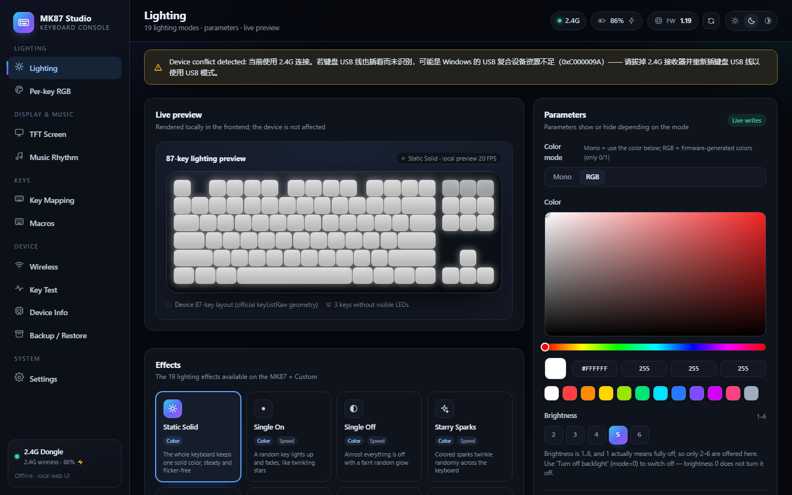
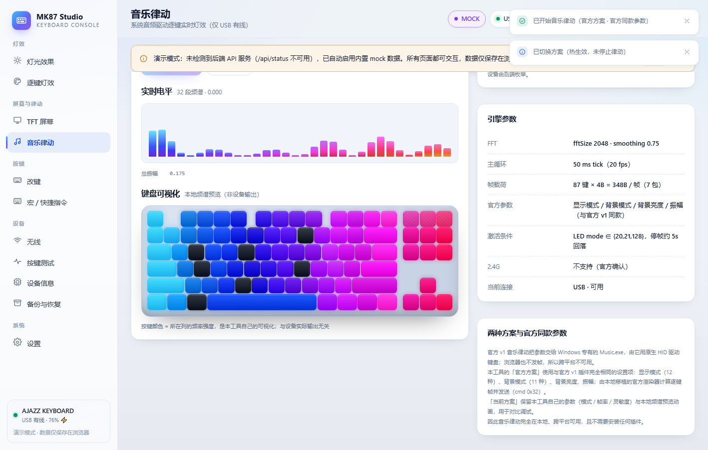
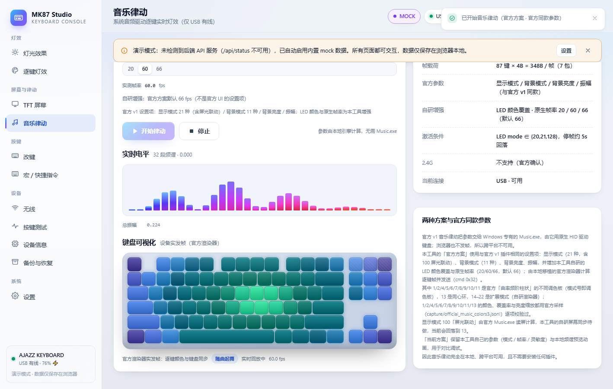
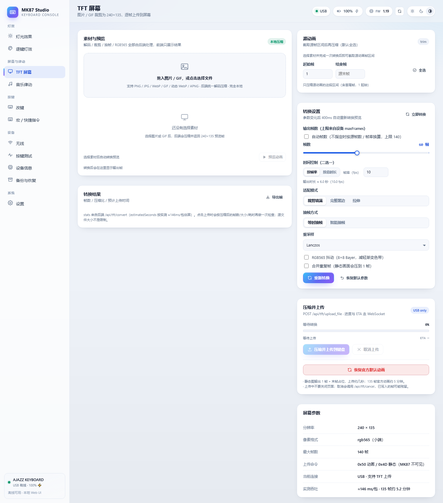
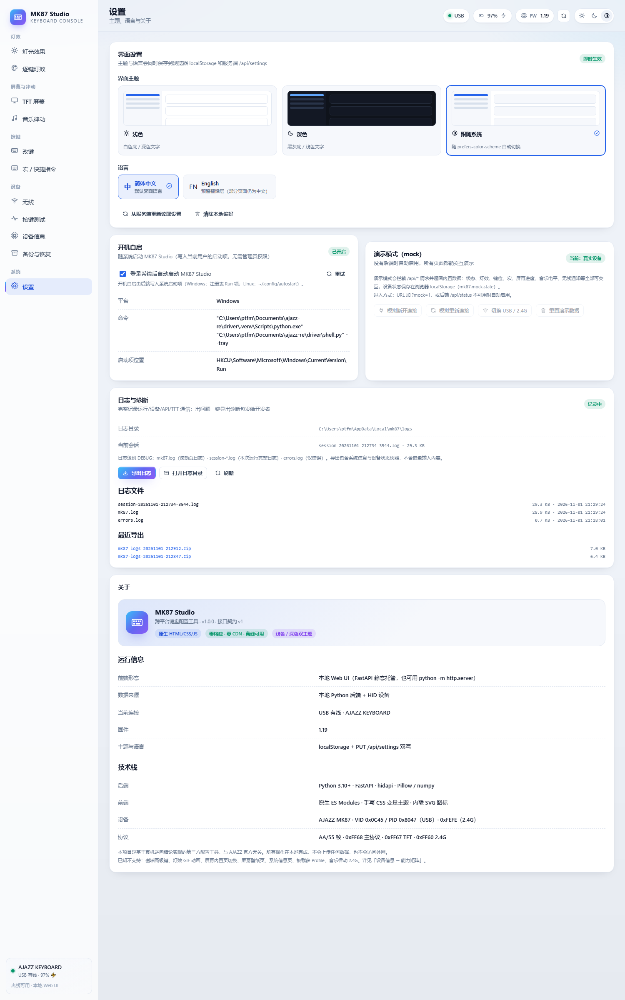

# AJAZZ MK87 · 逆向工程 + 跨平台配置工具

[English](README.md) · **简体中文**

**MK87 Studio** 是 AJAZZ MK87 机械键盘的非官方**跨平台配置工具**（Windows + Linux），基于对其
USB / 2.4G 协议的完整逆向实现，全部功能**离线本地运行**。

- **设备**：USB `VID 0x0C45 / PID 0x8047`；2.4G 接收器 `VID 0x0C45 / PID 0xFEFE`
- **官方网页驱动**（已逆向）：`https://ajazz.driveall.cn`
- **全程本地**：不访问外网、不上传数据、不依赖官方驱动
- **最新版本**：[v0.1.7](https://github.com/w32394045-dotcom/ajazz-mk87/releases/latest)

## 界面截图

| 灯光效果（浅色 · 中文） | 深色界面（English） |
|---|---|
|  |  |

| 音乐律动 · 当前方案 | 音乐律动 · 官方方案 |
|---|---|
|  |  |

| TFT 屏幕（240×135） | 日志与诊断 |
|---|---|
|  |  |

> 音乐律动两张为无硬件演示模式截图，其余为真机界面。

## 下载

👉 **https://github.com/w32394045-dotcom/ajazz-mk87/releases/latest**

| 平台 | 文件 | 说明 |
|---|---|---|
| Windows | `MK87Studio-*-win64-portable.zip` | 免安装：解压后双击 `MK87Config.exe` |
| Windows | `MK87Studio-*-win64-setup.exe` | 安装版：快捷方式、可选开机自启 |
| Linux · Debian/Ubuntu | `mk87_*_amd64.deb` | `sudo apt install ./mk87_*.deb` |
| Linux · Fedora/openSUSE | `mk87-*.x86_64.rpm` | `sudo dnf install ./mk87-*.rpm` |

Linux 包内已包含 udev 规则（免 root 访问 HID），安装后请重新插拔键盘。
发布由 GitHub Actions 自动构建，附件含 `SHA256SUMS.txt` 校验值。

如果 Linux 上识别不到键盘，先跑内置自检：

```bash
mk87 --diagnose     # 打印 hidapi 后端、hidraw 节点、usage page、权限
```

同一份报告会保存到 `~/.local/state/mk87/logs/diagnose.txt`。Linux 上本工具必须使用 hidapi 的 **hidraw**
后端（模块 `hidraw`，路径 `/dev/hidrawN`）；PyPI wheel 里的 `hid` 模块是 **libusb** 后端，不能用来配置
这把键盘（设备路径不对、没有 usage page、需要 /dev/bus/usb 权限还会和内核 HID 驱动抢接口）。详见
下方 v0.1.6 更新说明。

## v0.1.7 更新

- **修复：Linux 上音乐律动无法启动（HTTP 400）** —— 音频采集原来依赖外部命令 `parec`
  （`pulseaudio-utils`），而 PipeWire 桌面（Fedora、现在的 Debian/Ubuntu）默认不装，
  于是 `POST /api/music/start` 立刻失败并提示「音频采集打开失败」。现在 Linux 直接调用
  **libpulse-simple**（`libpulse0` / `pulseaudio-libs` 自带，安装包已声明依赖，PulseAudio 和
  PipeWire 的 pulse 兼容层都能用）打开 `@DEFAULT_MONITOR@`；若系统不认这个特殊源名，会用
  `pactl get-default-sink` 得到真实名 `<默认 sink>.monitor` 再试一次；库缺失时仍回退 `parec`。
  音频设备列表也不再依赖 `pactl`（缺失时回落到「默认输出回环」）；当前使用的后端通过
  `/api/music/status` 的 `audioBackend` 字段暴露，失败原因会写进日志（`MK87Error ...: message`），
  不再只有一个 400。
- **修复：设备命令无谓变慢（主要是 Windows）** —— 通知监听线程每次都在**持有设备锁**的情况下做
  「带超时的 HID 读」。Windows 上这个读在超时路径要走 CancelIoEx，实测要 50~400ms 才返回，
  于是改键 / 宏 / 灯效每个请求都白等约 0.3 秒；Linux 上是 50ms，通知帧连续时甚至会把请求线程饿住。
  现在监听线程改为**非阻塞读 + 释放锁后再 sleep**（`timeout<=0` 路径；注意 cython-hidapi 的
  `read(len, 0)` 其实是阻塞的，所以用 `set_nonblocking(1)` + `read(len)`）。真机 MK87（Windows）
  实测：改键矩阵读取 **15ms**（原来经 API 约 325ms）、逐键灯读取 **24ms**（原来 100~250ms）、
  设备信息 **2ms**；音乐帧流仍稳定 20.0fps。
- **卡顿诊断增强** —— 新增进程级看门狗：每 0.5s 采样，间隔 >2s 说明**整个进程被冻结/挂起**
  （与「某个线程等锁」区分开）；设备锁等待 >0.3s、HID 写 >0.5s、读明显超时都会写 WARNING；
  HTTP 400 现在会记录 `MK87Error` 的具体 reason。这些来自 2026-11-04 的用户日志——里面有多次
  2~9 秒「完全没有日志」的窗口，下一份日志就能判断是进程被挂起还是设备操作卡住。
- **测试**：**245 个单元测试全绿**（新增 12 个 Linux 音频测试 + 非阻塞监听/读取测试）。
  Linux 真机验证（音乐律动）仍需你在你的机器上装包确认。
### v0.1.6

- **修复：Linux 上仍然识别不到键盘（v0.1.5 反馈的真正根因）** —— PyPI 的 `hidapi` wheel 在 Linux 上
  打包了**两个**扩展模块：`hid`（libusb 后端）和 `hidraw`（hidraw 后端）。cython-hidapi 的构建默认把
  `hid` 编成 libusb 后端，所以 `import hid` 在 Linux 上拿到的是 libusb 实现：枚举出来的 path 是
  `1-1.1:1.0` 这类总线路径（不是 `/dev/hidrawN`），`usage_page` 恒为 0（libusb 枚举时读不到描述符），
  打开还需要 `/dev/bus/usb` 权限、并会和内核 HID 驱动抢接口。现在 Linux 上改用 `hidraw` 后端：path 是
  `/dev/hidrawN`，usage page 直接由 sysfs 解析；v0.1.5 的 report descriptor 解析保留为兜底。
  Windows 继续用原生 `hid` 模块，行为不变。
- **新增 `--diagnose` 自检** —— `mk87 --diagnose`（源码环境用
  `python3 probe/linux_hid_check.py`）会打印：hidapi 后端、原始枚举结果、本工具解析出的接口、
  每个 `/sys/class/hidraw/hidraw*` 节点的 vid/pid/接口号/usage page/权限、udev 规则状态和结论，
  并保存到 `~/.local/state/mk87/logs/diagnose.txt`。
- **Linux 报错更明确** —— 只剩 libusb 后端时不再假装连接，直接提示安装官方 wheel / 升级安装包；
  「找不到设备」的提示里带上 `--diagnose`。
- **Linux 启动日志更干净** —— 明确让 pywebview 用 Qt 后端，不再先刷一条误导性的
  `GTK cannot be loaded` traceback 再回退。
- 测试：**226 个单元测试全绿**（新增 11 个：后端选择优先级、接口号 0 的保留、sysfs HID_ID/接口号解析、
  libusb 风格 path 的 sysfs 兜底、libusb 后端拦截）。Windows 真机回归：`connected=True fw=1.19
  battery=100 tftMax=140`。

### v0.1.5

- **Linux 修复尝试（report descriptor 解析）** —— v0.1.5 误以为 hidapi 的 hidraw 后端在 Linux 上不填
  `usage_page`，于是给每个接口自己读 HID report descriptor 重新解析 usage page（见 v0.1.6 根因：实际是
  **libusb** 后端被导入）。这套解析保留作为兜底。
- 诊断增强：设备日志列出每个枚举接口；`probe/linux_hid_check.py` 一键打印同样信息。
- 测试：215 个单元测试全绿（新增 9 个 Linux 传输测试）。

### v0.1.4

- **修复：改键 / 宏绑定保存失败** —— 改键页面发送的是 `key` / `fn` / `combo` 动作格式，后端编码器只认
  `keyboard` / `func` / `combo(mods+key)`，所以每次「应用修改」都返回 HTTP 400。现在后端两种格式都兼容，
  前端改为发送标准格式；组合键刷新页面后也能正确回显。真机（MK87）验证：标准格式、旧别名 key、组合键写入
  + 恢复、FN 层 no-op 保存全部 200 且回读字节一致。
- **修复：播放音乐时界面周期性卡顿** —— 协议层把每个 HID 通知帧都按 DEBUG 逐条写日志（一次 47 分钟的
  66fps 会话写了 **118 万行 / 207MB**）。现在通知按类聚合并限速（≈33KB/分钟，降幅 99.9%），会话日志
  上限 32MB 且自动清理旧会话，宏表改为整块批量读（`GET /api/macros` 48 秒 → 0.37 秒，请求数 201 → 7）。
- **修复：LED 颜色覆盖扩展到全部动态模式** —— 原来只对 1/2/4/5/13 生效，现在补回的 14–22 也能上色；
  纯色 6–11 保持官方采样色，`default` 仍与旧版逐字节一致（220 组合快照回归）。
- **修复：模式 4 会闪回旧合成轮廓** —— 某一帧 17 段频谱全 0（安静段落/回环瞬时断流）时会退回旧的
  「曲率轮廓」观感。现在真实音频链路给过频谱后永不退回，静音就是柱子归零。
- **修复：振幅 / 背景亮度滑块不生效** —— 两个滑块的 `onInput` 没有把新值写回变量，热更新永远发旧值
  （50 / 100）。现在拖动即实时生效。
- **修复：浏览器模式（`run.py`）日志失效** —— uvicorn 默认日志配置会关掉本工具的 handler（会话日志空白、
  stderr 刷出几万条 "Logging error"）。现在与原生外壳一致，`log_config=None`。

### v0.1.3

- **音乐律动 · 官方方案对齐官方 v1 真值** —— 显示模式下拉补回至 **21 项**：官方 v1 UI 原有的 12 项，
  加上之前逆向出、但官方 UI 没暴露的 9 项（14–22）。模式 4「曲率频阶」按官方 MusicPlug.exe 重新采样
  重写：17 列频谱柱、底部对齐（1200/1200 帧）、左低右高（对数，约 110Hz–12kHz）、径向色相以 `(2,8)`
  为原点、整块调色板约 275°/s 旋转。100 屏光联动仍回落「随曲起舞」。
- **LED 颜色（本工具自研增强）** —— 第三个下拉提供 **默认（官方配色）+ 9 套预设**：冰蓝 `#00E5FF`、
  紫罗兰 `#B36CFF`、热粉 `#FF2E88`、青柠 `#A8FF3E`、暖橙 `#FF6A00`，以及樱花
  `#FF7AB6→#B36CFF`、极光 `#3EFF9A→#00E5FF→#7A5CFF`、日落 `#FFC400→#FF6A00→#FF2E88`、
  冰火 `#00E5FF→#FEFEFE→#FF6A00` 渐变。作用于全部动态多色模式 **1/2/4/5/13 与补回的 14–22**，
  按原调色板位置/角度/相位在新渐变上采样并保留原有动画；纯色模式 6–11 与背景完全不受影响；
  `default` 与 v0.1.2 逐字节一致（220 组合快照回归）。
- **原生 20 / 60 / 66fps，默认 66** —— 官方 v1 实测 530.5 包/s ÷ 8 包/帧 ≈ **66.3fps**，官方方案默认
  66fps（当前方案仍为 15/20/30）。≤30fps 逐包 ACK；≥60fps 连写 7 包 + ACK 清道夫线程异步读回包
  （同步帧末 drain 实测 19.8ms/帧 → 只有 45.96fps；异步后 8.85ms/帧 → 66fps）。动画按实际帧间隔归一
  （dt_scale），切帧率观感速度不变。真机（USB fw1.19）66fps 连续 100s 实测 **65.78–65.89fps**（0 错误）；
  60fps=60.06、20fps=19.97；21 个模式 × 10 种颜色逐个切换 0 错误；停止后灯效恢复原值
  （mode=11、brightness=6、speed=3）。页面显示实测 fps，status 契约 `fps`=实测 float|null、
  `targetFps`=配置 int，WS 预览限速 30Hz。
- **电量 / 灯效健壮性** —— 电量、充电、工作模式每次读取都刷新并记日志（连接日志带
  battery/charging/workMode/transport，连接后延迟 2s 重读）；新增 2.4G 电量读取路径（cmd `0x37` 首包 +
  `GET_ALL_LIGHTS_RGB_24G` 回包），连续失败 3 次熔断 5 分钟并回退 USB 路径。灯效卡死根因修复：
  v0.1.2 音乐启动会写 LED mode **128**，进程被关机杀死时恢复逻辑没跑，fw1.19 把 128 固化成逐键自定义表
  （回读 mode=0）。现在音乐/帧流入口**绝不写 128**，帧模式固定写 20/21 并回读校验；恢复快照前校验
  mode，0/非法一律不写；退出顺序改为「停音乐并等恢复 → 按键测试 → 关设备管理器」；`GET /api/lighting` 在 mode 回读 0 时
  用 `GET_ALL_LIGHTS_RGB` 判断是否自定义并标 `isCustom`。（「重启后像游戏模式」与上条同源；全量日志证实
  工具从未写过 game-mode，0 条 cmd `0x21`。）
- **质量** —— 152 个单元测试全绿；无头 Chrome UI 自检 17 项 PASS（21 模式 / 3 下拉 / 10 颜色 /
  3 帧率档、热切换、英文界面无中文残留）。

## 功能

- **灯光效果** —— 19 种预设 + 颜色 / 亮度(1–6) / 速度(1–6) / 方向；RGB 或单色。
- **逐键灯效** —— 87 键画布：画笔、擦除、填充、吸管、拖拽连续上色、预设涂色；写入固件
  mode 20 / 21 / 128 共用的自定义灯表。
- **TFT 屏幕（240×135）** —— 图片 / GIF / 动态 WebP / APNG → 压缩管线（降采样、抽帧、去重、
  RGB565 抖动）→ 动画上传（≤140 帧）、时间同步、一键恢复官方默认动画。
- **宏** —— 100 槽 / 3072B 编辑器：录键、延迟、按下/抬起、重复 N 次、再按结束。
- **改键 / FN** —— 87 键主层 + FN 层：HID 键、组合键、宏、固件 FUNC 动作、禁用、恢复默认，
  实时预览 4B 编码；2.4G 下 FN 层只读。
- **音乐律动（仅 USB）** —— 两种方案：**官方方案**（21 种显示模式：官方 v1 的 12 项 + 补回的 14–22
  共 9 项 / 背景模式 11 种 / 背景亮度 / 振幅 / LED 颜色，播放中热切换）与**当前方案**（本工具的模式 /
  帧率 / 灵敏度）→ 原生 **20/60/66fps** 逐键帧流（官方方案默认 66；官方 v1 实测约 66.3fps）。模式 4
  为 17 列底部对齐频谱柱；LED 颜色覆盖（默认 + 9 套预设）可重着色全部动态模式
  （1/2/4/5/13 与补回的 14–22）。100 屏光联动由 Music.exe 计算，回落「随曲起舞」。
- **无线** —— 2.4G 状态、电量、休眠时间（0/1/10/20/30 分钟）、断连 / 唤醒通知日志。
- **按键测试** —— OS 级捕获（Windows RawInput / Linux evdev），87 键三态高亮、事件日志、统计。
- **设备信息** —— 固件 / 电量 / 能力矩阵、游戏模式字段、时间同步、原始命令控制台。
- **备份恢复** —— 全量 JSON 导出 / 导入，恢复前二次确认。
- **设置** —— 浅色 / 深色 / 跟随系统、简体中文 / English 即时切换、开机自启、干净退出。
- **其它** —— 系统托盘、单实例、完整日志 + 一键导出诊断包。

## 设备能力（真机实测）

| 能力 | 状态 |
|---|---|
| 87 键改键（HID / 组合键 / 宏 / FN / 媒体键） | ✅ 可读写 |
| FN 层改键（26 条默认动作） | ✅ 可读写 |
| 19 种灯效 + 亮度 / 速度 + 逐键自定义灯 | ✅ |
| 逐键实时帧流（原生 20/60/66fps，默认 66；官方 v1 约 66.3fps；音乐律动 / AI 灯效） | ✅ 仅 USB（2.4G 固件不支持） |
| 宏：100 槽 / 3072B，格式完全还原 | ✅ 可读写 |
| TFT 240×135 自定义动画（≤140 帧，约 63 KB/s） | ✅ 可上传播放 |
| 屏幕时间同步 | ✅ |
| 游戏模式 / 休眠设置、电池 / 固件信息 | ✅ 部分字段 |
| 2.4G 无线（配置与 USB 共享，矩阵一致）+ 断连 / 唤醒通知 | ✅ |
| 磁轴、灯效 GIF、板载多 Profile、屏幕内置页、12/24h 显示 | ⛔ 固件 / 硬件不支持 |

## 仓库内容

1. **逆向文档（`docs/`）** —— 协议帧格式、66 条命令表、按键 / 宏二进制格式、19 种灯效参数、
   逐键 LED 帧流、TFT 屏幕（240×135 动画 / 时间同步）、音乐律动、2.4G 无线（休眠 / 唤醒通知）、
   官方 i18n 文案与未知项清单。
2. **参考实现与取证脚本（`scripts/`、`probe/`、`capture/`）** —— 带自检断言的编解码参考实现、
   直接驱动设备的 Python HID 客户端、Chrome CDP WebHID 抓包工具。
3. **跨平台工具（`driver/`）** —— 已发布的 Windows + Linux 应用，覆盖上述全部已验证能力。

```
docs/      逆向文档与实测数据（JSON 证据）
scripts/   参考实现与提取脚本（Node/Python）
probe/     真机测试脚本（Python + hidapi）
capture/   Chrome CDP WebHID 抓包与录制证据
assets/    官方网页驱动 bundle 提取物（分析原料）
driver/    跨平台配置工具（已发布）
```

## 逆向文档

- [docs/FEATURES.md](docs/FEATURES.md) —— 功能总表与能力边界（先看这个）
- [docs/TEST-REPORT.md](docs/TEST-REPORT.md) —— 真机测试报告（Phase 0–7 与证据）
- [docs/protocol.md](docs/protocol.md) —— 帧格式与命令表
- [docs/deepdive-mk87.md](docs/deepdive-mk87.md) —— 设备信息 / 游戏模式 / 屏幕时间
- [docs/keymap.md](docs/keymap.md) —— 按键映射与宏二进制格式（§16）
- [docs/lighting.md](docs/lighting.md) —— 灯效协议
- [docs/tft-page.md](docs/tft-page.md) —— TFT 屏幕协议
- [docs/music-rhythm.md](docs/music-rhythm.md) —— 音乐律动与逐键帧流
- [docs/wireless-profiles-led-animation.md](docs/wireless-profiles-led-animation.md) —— 2.4G 无线
- [docs/key-events.md](docs/key-events.md) —— 按键事件捕获（厂商协议无事件帧，需 RawInput/evdev）
- [docs/i18n-and-unknowns.md](docs/i18n-and-unknowns.md) —— 官方文案与未决项
- [driver/README.md](driver/README.md) —— 工具本身的说明

## 从源码构建与运行

```bash
git clone https://github.com/w32394045-dotcom/ajazz-mk87.git
cd ajazz-mk87/driver
python -m venv .venv

# Windows
.venv\Scripts\pip install -r packaging\requirements.txt
.venv\Scripts\python shell.py      # 原生窗口（推荐）
# .venv\Scripts\python run.py      # 浏览器模式

# Linux
.venv/bin/pip install -r packaging/requirements.txt
.venv/bin/python shell.py           # 原生窗口（需 Qt WebEngine）
# .venv/bin/python run.py           # 浏览器模式
```

## 许可证

MIT License，见 [LICENSE](LICENSE)。

> 注意：`assets/`、`tools/Music.exe`、`docs/` 中的官方 bundle 片段等原厂提取物版权归原厂所有，
> **不在 MIT 授权范围内**。

## 免责声明

非官方逆向工程，仅用于研究与个人使用，与 AJAZZ 官方无关。设备固件 / 协议可能随版本变化；
写操作（改键、宏、灯效、屏幕内容）前请自行备份。
