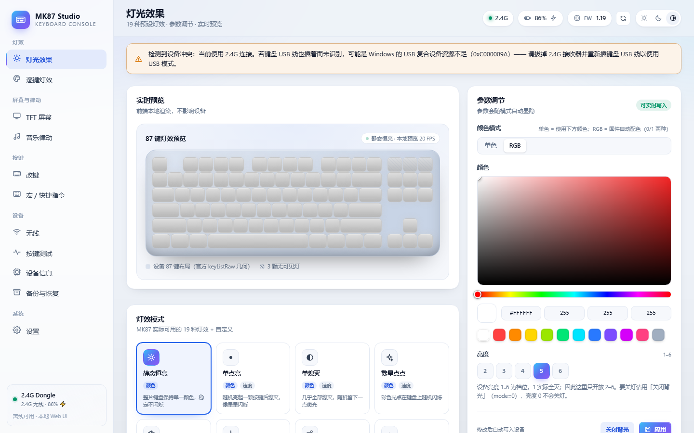
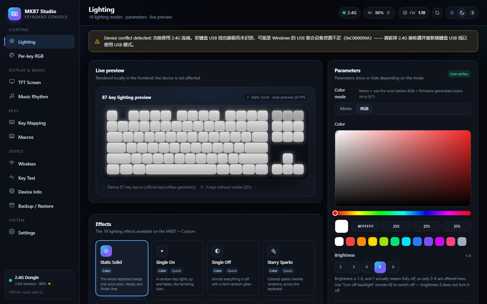

# MK87 配置工具（跨平台 / Linux + Windows）

AJAZZ MK87（USB `0C45:8047` / 2.4G 接收器 `0C45:FEFE`）的**本地网页图形配置工具**，
基于本仓库逆向出的完整协议实现，覆盖官方网页驱动没有开放的能力。

- **平台**：Windows 10/11、Linux（hidapi / RawInput / evdev，无内核驱动、无需管理员权限*）
- **形态**：本地启动一个服务（默认 `127.0.0.1:8477`）并自动打开浏览器，全部资源本地、离线可用
- **主题**：浅色（白色）与深色（黑色）两套，可跟随系统
- **协议来源**：[`../docs/FEATURES.md`](../docs/FEATURES.md)、[`../docs/TEST-REPORT.md`](../docs/TEST-REPORT.md)（静态逆向 + 真机验证）

> *仅「设备冲突诊断」类操作在 Windows 上可能提示管理员权限；配置键盘本身不需要。

## 功能

| 页面 | 能力 |
|---|---|
| 灯光 | 19 种灯效（静态/呼吸/光谱/涟漪/繁星…）+ 颜色/亮度(1–6)/速度(1–6)/方向；RGB/单色；亮度 1 = 全灭（关灯用 mode 0） |
| 逐键灯效 | 87 键画布：画笔/擦除/填充/吸管、拖拽连续上色、预设涂色，写入设备自定义灯表（mode 20/21/128 共用） |
| 屏幕 | 高分辨率图片/GIF/动态 WebP/APNG → **自研压缩管线**（降采样+抽帧+去重+RGB565 抖动）→ 240×135 动画上传（≤140 帧、用户自定帧数、源帧区间裁剪、预计上传时间），一键恢复官方默认动画 |
| 宏 | 100 槽 / 3072B 宏编辑器：录键、延迟、按下/抬起、重复播放 N 次、再按结束（mask 0/1/2 真机验证） |
| 改键 / FN | 87 键改键：HID 键、多媒体、组合键、宏、固件 FUNC 动作、禁用、恢复默认；FN 层单独编辑（2.4G 下 FN 只读需 USB） |
| 音乐律动 | 系统音频回环采集 → 官方渲染器（律动节拍/光尘螺旋/萤火轨迹/曲率频谱/细曲率），20fps 逐键帧流（**仅 USB**）；页面可切换「当前方案 / 官方方案」：官方方案使用与官方 v1 插件完全相同的设置项（显示模式 12 种 / 背景模式 11 种 / 背景亮度 / 振幅），运行中热切换不打断音乐 |
| 无线 | 2.4G 连接状态、电量、休眠时间（0/1/10/20/30 分钟）、断连/唤醒通知日志 |
| 按键测试 | OS 级按键捕获（Windows RawInput / Linux evdev），87 键三态高亮 + 事件日志 + 统计 |
| 设备信息 | 固件/电量/能力矩阵/游戏模式字段、时间同步、原始命令控制台（hex 收发） |
| 备份恢复 | 全量导出/导入 JSON（改键/FN/宏/灯效/自定义灯/游戏模式），恢复前二次确认 |
| 设置 | 浅色/深色/跟随系统、简体中文/English 即时切换、开机自启、退出程序 |

## 界面截图

| 浅色 · 中文 | 深色 · English |
|---|---|
|  |  |

支持「浅色（白色）/ 深色（黑色）」两套 GUI 主题（可跟随系统），以及简体中文 / English 即时切换。

## 快速开始

### Windows

```powershell
cd driver
python -m venv .venv
.venv\Scripts\pip install -r packaging\requirements.txt
.venv\Scripts\python shell.py          # 原生桌面窗口（推荐）
# 或纯浏览器模式： .venv\Scripts\python run.py
```

打包成品：`powershell -ExecutionPolicy Bypass -File packaging\windows\build-portable.ps1`
（便携 zip）或 `packaging\windows\build-installer.ps1`（安装包，需 Inno Setup 6）。
产物：`dist\MK87Config\MK87Config.exe`（双击即用，无控制台）、`dist-packages\*.zip`、`dist-installer\*setup.exe`。

### Linux

```bash
cd driver
bash packaging/install-linux.sh        # 建 venv + 装依赖 + 安装 udev 规则（需要 sudo）
.venv/bin/python shell.py              # 原生桌面窗口
# 或安装 deb/rpm：
bash packaging/linux/make-package.sh   # 需要 dpkg-dev / rpm-build
```

### 启动方式对比

| 方式 | 命令 | 说明 |
|---|---|---|
| 原生窗口（推荐） | `python shell.py` / 打包后的 `MK87Config.exe` | 独立窗口 + 系统托盘；关窗口隐藏到托盘；托盘菜单可真正退出 |
| 静默到托盘 | `shell.py --tray` / `MK87Config.exe --tray` | 开机自启用，不弹主窗口 |
| 浏览器模式 | `python run.py` | 起本地服务并自动打开浏览器（开发/远程调试用） |

### 系统托盘与开机自启

- 点窗口右上角 X：**不退出**，隐藏到托盘继续运行；
- 托盘双击 / 「显示主窗口」：唤起窗口；
- 托盘「开机自启」：勾选后开机静默启动到托盘；
- 托盘「退出」：停后台任务 → 停服务 → 关窗口/托盘 → 进程干净退出（实测 2–4 秒，无残留）；
- 设置页也可打开/关闭「开机自启」，并提供「退出程序」按钮（仅原生外壳模式可见）。

## 命令行（mk87ctl）

不需要 GUI 也能操作，适合脚本化 / 硬件回归：

```bash
python cli.py status
python cli.py info
python cli.py keymap set 103 keyboard 4          # Insert -> A
python cli.py keymap set 33 combo 224 6          # Q -> Ctrl+C
python cli.py lighting set 1 --rgb FF0000 --brightness 5
python cli.py lighting custom --colors "0:FF0000,1:00FF00" --apply
python cli.py macro apply macros.json
python cli.py tft upload demo.gif --fps 10
python cli.py tft default                        # 恢复官方默认动画
python cli.py wireless --sleep 10
python cli.py backup dump backup.json
python cli.py backup restore backup.json --confirm
python cli.py music start --seconds 10 --style spectrum
python cli.py keytest 10
```

## HTTP API

完整契约见 [`docs/design.md`](docs/design.md) §4；服务启动后打开 `http://127.0.0.1:8477/api/docs`
可看 OpenAPI 文档。WebSocket `/ws` 推送状态、电量、通知、上传进度、按键事件。

## 设备兼容与已知限制

- **2.4G 模式**：改键/FN/宏/灯效/自定义灯/无线设置全部可用；**TFT 上传与音乐律动仅 USB**（官方确认 2.4G 不支持音乐）。
- **USB + 2.4G 同时插**：若两者接在同一个 USB2.0 Hub 上，Windows 可能给后枚举的复合设备报
  `0xC000009A`（资源不足），导致键盘 USB 不被识别。工具会提示处理方式：拔掉 2.4G 接收器使用 USB 模式，
  或拔掉 USB 线使用 2.4G 模式（软件禁用方案实测不可行，见 TEST-REPORT §8.7）。
- **无法写入的能力**（固件/硬件不支持，UI 不提供）：磁轴、灯效 GIF、板载多 Profile、屏幕内置页/壁纸页/
  系统信息页、屏幕 12/24h 可见效果、OTA 升级。
- **屏幕时间**：连接后自动同步主机时间（与官方一致）。
- 亮度字段 identity 1..6，其中 **1 = 全灭**；越界值未定义，工具钳制到 1..6。
- **23 个空槽 / 97/98 槽**：97/98 有 LED 驱动通道但无可见光；99/100/102 位置是屏幕。

## 安全建议

写操作会立即生效。首次使用建议先 **备份恢复 → 导出备份**；实验后可用「恢复出厂设置」
（FN+空格 或 设备信息页按钮）恢复默认。工具不会修改固件、不会 OTA。

## 目录结构

```
driver/
├── mk87lib/            协议核心库（可单独 import）
│   ├── transport.py    hidapi 封装（Win/Linux）
│   ├── protocol.py     AA/55 帧协议
│   ├── device.py       设备对象 + 通知线程
│   ├── keymap.py       改键/FN 编解码
│   ├── macro.py        宏表编解码
│   ├── lighting.py     灯效 / 自定义灯 / 0x32 帧流
│   ├── tft.py          屏幕图片/动画上传
│   ├── music.py        音乐律动（音频采集 + 渲染）
│   ├── wireless.py     2.4G
│   ├── keyscan.py      按键捕获（RawInput/evdev）
│   └── backup.py       备份/恢复
├── server/             FastAPI 服务（app.py / state.py）
├── web/                前端（原生 HTML/CSS/JS，零构建、浅色+深色主题）
├── data/               运行时数据（键位/灯效元数据/默认动画）
├── docs/               架构契约 design.md + 逆向规格 spec-*.md
├── packaging/          PyInstaller 打包、udev 规则、依赖清单
├── cli.py              命令行
└── run.py              启动入口
```

## 开发

```bash
# 从 docs/ 重新生成运行时数据（键位/灯效/默认动画）
python tools/build_data.py
# 离线单元测试（协议编解码，不需要设备）
python -m unittest discover -s tests -v
# 设备冒烟（需要连接键盘）
python tests/smoke_device.py
```

协议细节见 [`docs/spec-protocol.md`](docs/spec-protocol.md)、[`docs/spec-keymap.md`](docs/spec-keymap.md)、
[`docs/spec-lighting.md`](docs/spec-lighting.md)、[`docs/spec-tft-wireless.md`](docs/spec-tft-wireless.md)。

## 许可证

MIT License（见仓库根目录 [LICENSE](../LICENSE)）。

## 免责声明

非官方工具，仅供个人研究使用。写配置有风险（可能导致键位/灯效异常），请先备份；
设备固件升级可能改变行为，本工具不提供 OTA。
